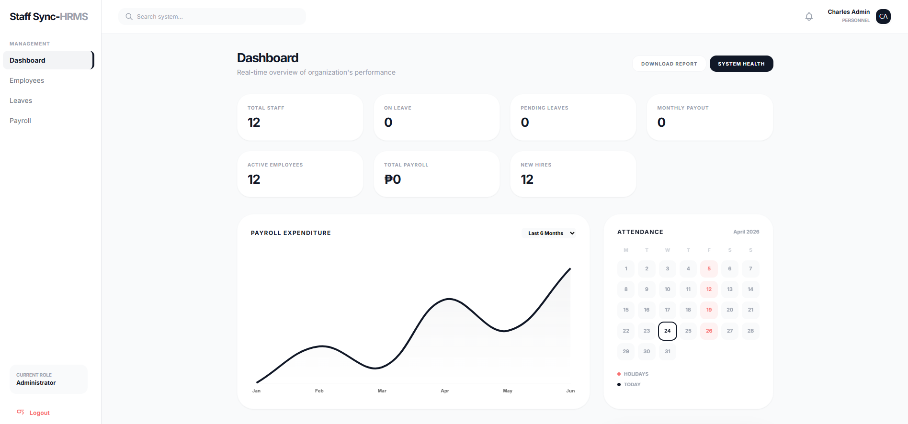
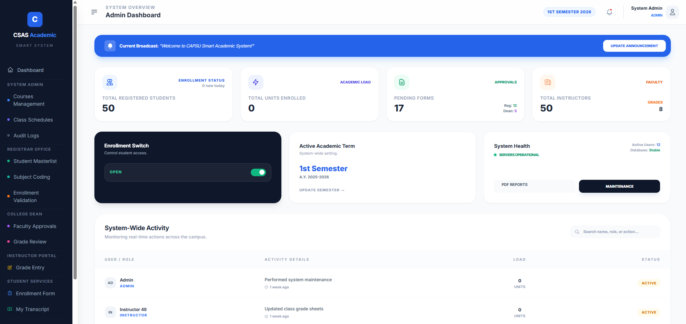
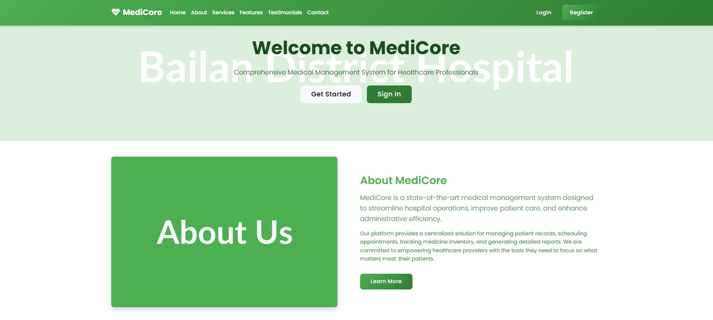

<!-- ═══════════════════════ HERO BANNER (animated) ═══════════════════════ -->

  

<!-- ═══════════════════════ INTRO CARD ═══════════════════════ -->
<table align="center">
  <tr>
    <td align="center" width="260">
      
        
      <b>Charles D. Cayetano</b> 
      📍 Panitan, Capiz, Philippines
    </td>
    <td align="left" width="520">
      <h2>Hi!👋 What's Up?</h2>
      

        💻 <b>Front-End Developer</b> | Aspiring <b>Full-Stack Developer</b> 
        🏗️ Specializing in <b>robust system architectures</b> 
        🎯 Scalable backends + clean, professional UI dashboards 
        🌱 Real-world enterprise systems: <i>Enrollment • HR • Academic • Healthcare</i>
      

      

        
        
      

    </td>
  </tr>
</table>

  

  
  

---

<!-- ═══════════════════════ LIVE NUMBERS ═══════════════════════ -->
## 📈 My Numbers (Live)

  
  
  

 

<!-- Animated cards from github-profile-summary-cards (hosted API) -->

  
  

  
  

  

 

<!-- ═══════════════════════ STREAK ═══════════════════════ -->

  

---

<!-- ═══════════════════════ PORTFOLIO PREVIEW ═══════════════════════ -->
## 🖥️ Portfolio Preview

  
   
  👆 Click to explore my full portfolio → <a href="https://chep.website"><b>chep.website</b></a>

---

<!-- ═══════════════════════ FEATURED PROJECTS ═══════════════════════ -->
## 🚀 Featured Projects

<table align="center">
  <tr>
    <td align="center" width="33%">
      
       <b>Staff-HRMS</b> 
      👥 HR Management System
    </td>
    <td align="center" width="33%">
      
       <b>CSAS</b> 
      🎓 Enterprise System
    </td>
    <td align="center" width="33%">
      
       <b>Medicore</b> 
      🏥 Healthcare System
    </td>
  </tr>
</table>

More projects on my portfolio → <a href="https://chep.website"><b>chep.website</b></a>

---

<!-- ═══════════════════════ WHAT I BUILD ═══════════════════════ -->
## 🏗️ What I Build

| 🎓 Enrollment Systems | 👥 HR Systems | 📚 Academic Systems | 🏥 Healthcare Systems |
| :---: | :---: | :---: | :---: |
| Student records, registration & enrollment flow | Employee records, management & workflows | Grades, subjects, schedules & school operations | Patient records & clinic / hospital workflows |

  
  
  
  

---

<!-- ═══════════════════════ TECH STACK ═══════════════════════ -->
## 🛠️ Tech Stack

  

 

| Layer | Tools |
| :---: | :--- |
| 🎨 **Front-End** | React • Next.js • Vue • TypeScript • JavaScript • Tailwind CSS • Bootstrap |
| ⚙️ **Back-End** | PHP • Laravel |
| 🗄️ **Database** | MySQL • PostgreSQL |
| 🧰 **Tools** | Git • GitHub • VS Code |

---

<!-- ═══════════════════════ CONNECT ═══════════════════════ -->
## 📬 Connect With Me

  
  
  
  

---

<!-- ═══════════════════════ PHILOSOPHY ═══════════════════════ -->
## ⚡ Philosophy

  

  

